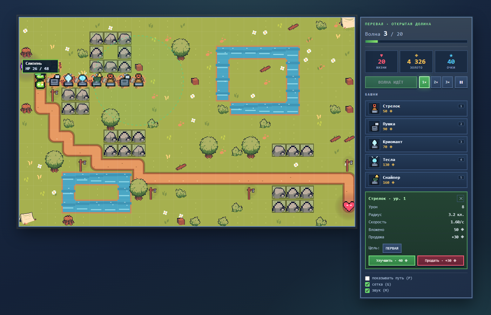
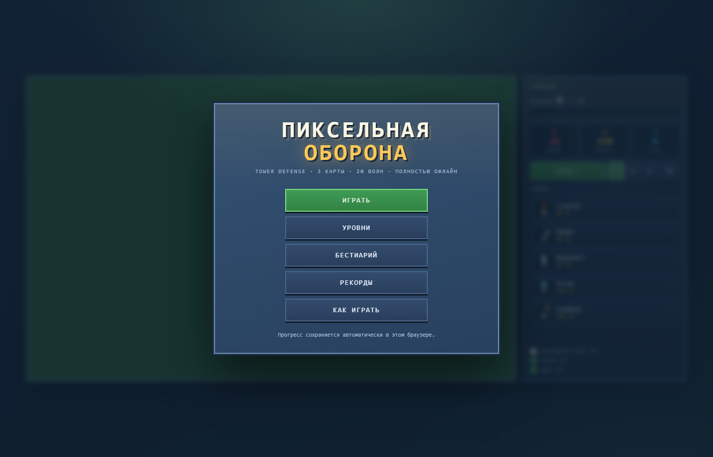
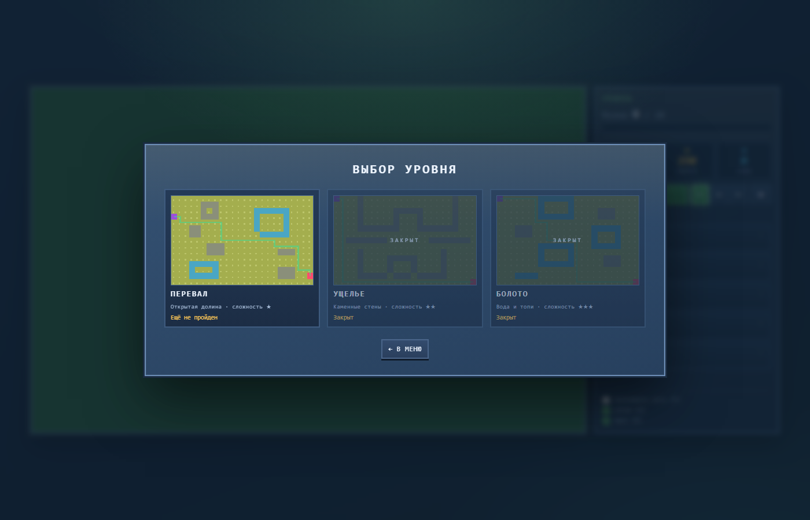
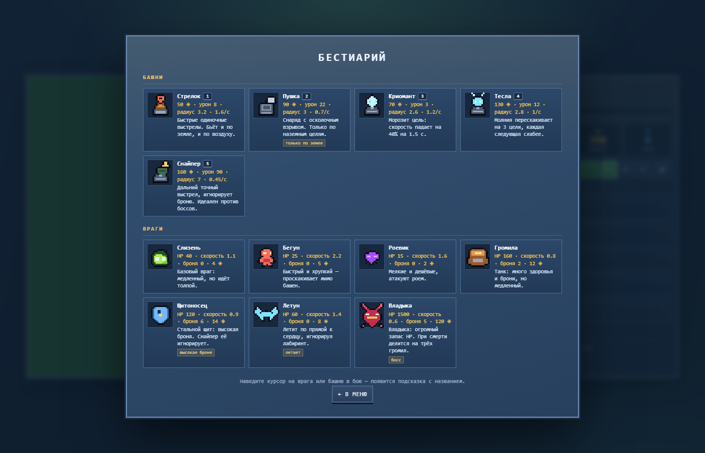
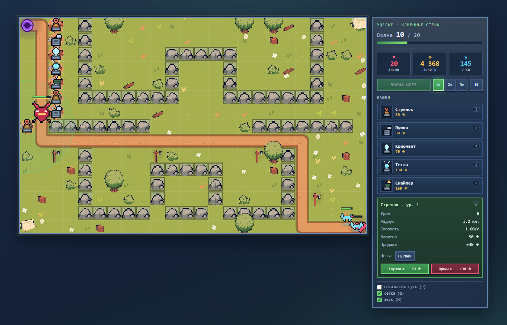

# Пиксельная Оборона

Tower Defense в браузере: яркая пиксельная графика в духе классических TD, три карты,
двадцать волн, лабиринт из башен. Работает **полностью офлайн** — двойной клик по
`index.html`, без установки, без сборки, без интернета и без единого внешнего файла:
графика рисуется кодом, звук синтезируется.



> Учебный проект, третья работа после Telegram-бота и сайта.
> Архитектура, баланс и история решений — в [docs/HANDOFF.md](docs/HANDOFF.md).

## Запуск

Откройте `index.html` в браузере (Chrome, Edge, Firefox). Больше ничего не требуется:
ни сервера, ни Node.js, ни интернета.

## Возможности

* Три карты с разной геометрией: «Перевал» (открытая долина), «Ущелье» (каменные
  коридоры), «Болото» (озёра и извилистые тропы).
* Пять башен — стрелок, пушка, криомант, тесла, снайпер — по три уровня улучшений.
  У каждой свои урон, радиус, скорость, тип атаки и режим выбора цели.
* Семь типов врагов: слизни, бегуны, рой, громилы, щитоносцы, летуны (игнорируют
  лабиринт) и боссы, которые при смерти делятся на трёх громил.
* Башни перекрывают путь: маршрут врагов пересчитывается алгоритмом A*, а полностью
  замуровать проход нельзя — игра проверяет путь перед каждой постройкой.
* Двадцать волн на карту, детерминированный генератор состава (одинаковый при
  перезапуске), досрочный запуск волны за бонус.
* Видимая песчаная дорога показывает текущий маршрут врагов, а под каждым врагом
  горит цветное кольцо его типа.
* **Бестиарий** со всеми башнями и врагами, а в бою — подсказка при наведении курсора
  на врага или башню.
* Скорость 1×/2×/3×, пауза, сохранение рекордов и прогресса в браузере.
* Звук синтезируется на WebAudio — аудиофайлов нет.
* Спрайты 16×16 описаны строками и палитрой и один раз рендерятся в canvas.

## Скриншоты

| Меню | Выбор уровня |
|---|---|
|  |  |





## Управление

| Клавиша | Действие |
|---|---|
| `1`–`5` | выбор башни |
| ЛКМ | построить / выделить |
| ПКМ | отмена / продать |
| `N` | следующая волна досрочно |
| `Space` | пауза |
| `U` / `S` | улучшить / продать выделенную |
| `P` | показать путь врагов |
| `G` / `M` | сетка / звук |
| `Esc` | снять выделение / пауза |

## Структура

```
index.html            разметка и подключение скриптов
css/style.css         оформление (светлая фэнтезийная тема)
js/core/util.js       неймспейс TD, математика, RNG, форматирование
js/core/sprites.js    процедурный пиксель-арт: строки-палитры → offscreen canvas
js/core/assets.js     загрузка тайлсета и объектов free-fields
js/core/audio.js      синтез звуков на WebAudio
js/data/maps.js       три карты в виде ASCII-строк 24×15
js/data/defs.js       конфигурация, таблицы башен и врагов
js/data/waves.js      детерминированный генератор 20 волн
js/logic/grid.js      сетка, A*, проверка «путь не перекрыт»
js/game.js            игровой цикл, башни, враги, снаряды, отрисовка
js/ui.js              экраны, HUD, магазин, инспектор, сохранения, бестиарий
js/main.js            точка входа
free-fields-tileset-pixel-art-for-tower-defense/  исходный набор ассетов
tests/run.js          юнит-тесты логики (Node)
tools/balance.js      симуляция баланса: бот проходит все карты
tools/ui-check.js     проверка интерфейса в headless-браузере
docs/                 документация и скриншоты
```

## Как это устроено

**Графика.** Поле, дорога, камни, деревья, трава, цветы, палатки и площадки под башни
берутся из набора **free-fields-tileset-pixel-art-for-tower-defense** (CraftPix):
`js/core/assets.js` загружает PNG локально и рисует их с `imageSmoothingEnabled = false`.
Башни и враги остаются процедурными спрайтами 16×16. Если ассеты не загрузились
(например, папку удалили), игра автоматически возвращается к цветному фолбэку и не падает.

**Без сборки и модулей.** Проект специально сделан на классических `<script>`:
Chrome блокирует ES-модули по `file://`, поэтому все файлы складывают код в глобальный
неймспейс `TD`. Порядок подключения важен: `util → sprites → assets → audio → maps →
defs → waves → grid → game → ui → main`.

**Лабиринт и A\*.** Сетка 24×15, клетка 40 px, canvas 960×600. Враг ходит по центрам
клеток по 4 направлениям (без диагоналей — иначе он «срезал» бы углы башен). При
постановке башни клетка мысленно занимается, запускается A* от портала к сердцу; если
пути нет — постройка отменяется с сообщением «Путь перекрыт». После успешной постройки
или продажи маршруты всех наземных врагов пересчитываются на лету.

**Логика без DOM.** `TD.Game` не обращается к `document` или `canvas`: он получает `dt`,
отдаёт состояние и умеет рисовать через переданный `ctx`. Поэтому тесты и симуляция
баланса гоняют ту же игровую логику в Node.

**Баланс.** HP врага растёт на 10% за волну и на 18% за карту; броня вычитается из урона,
но не ниже 1 (снайпер её игнорирует). Награда за волну `20 + 5 × номер`, досрочный запуск
даёт `10 + 2 × номер` золота. Старт: 250 золота и 20 жизней. Числа вынесены в
`js/data/defs.js`, состав волн — в `js/data/waves.js`.

## Тесты

```bash
node tests/run.js          # 30 юнит-тестов логики
node tools/balance.js      # бот проходит все 3 карты (симуляция)
node tools/ui-check.js     # 29 проверок интерфейса в headless Chrome/Edge
```

`tests/run.js` покрывает генерацию карт, A*, запрет перекрытия пути, урон с бронёй,
экономику, детерминированность волн, победу/поражение, сохранения, работу без
`localStorage` и наличие всех файлов ассетов.

`tools/balance.js` запускает простого бота: он строит башни у маршрута, улучшает их и
запускает волны. На текущем балансе все три карты проходятся (20/20 волн).

`tools/ui-check.js` управляет настоящим браузером через DevTools Protocol: кликает по
магазину и canvas, проверяет постройку, улучшение, продажу, волну, паузу, сохранение,
экран результата и отсутствие ошибок в консоли.

## Отладка

Для скриншотов и быстрой проверки можно открыть игру сразу с нужным уровнем:

```
index.html?test=1&level=0&wave=1&ff=300&demo=1&path=1
```

* `level` — индекс карты (0–2);
* `wave` / `waveNum` — начать с первой / с указанной волны;
* `ff` — прокрутить N шагов симуляции (1/30 с) до отрисовки;
* `demo` — построить демонстрационный набор башен (выдаётся золото);
* `path=1` — сразу показать путь;
* `hover=enemy|tower` — навести подсказку на первого врага или башню.

## Ассеты и лицензия

Тайлы поля и объекты (деревья, камни, трава, цветы, палатки, фонари, площадки под
башни) — набор **Free Fields Tileset Pixel Art for Tower Defense** от
[CraftPix.net](https://craftpix.net/). Условия использования — в файле
[License.txt](free-fields-tileset-pixel-art-for-tower-defense/License.txt)
(https://craftpix.net/file-licenses/). Файлы лежат локально в папке проекта;
игра не обращается в интернет.

## Статус

Игра готова: все экраны, три карты по 20 волн, пять башен с улучшениями, семь типов
врагов, сохранения и звук. Тесты и симуляция баланса проходят. Осталось только
опубликовать репозиторий (см. `docs/HANDOFF.md`, раздел 9).
