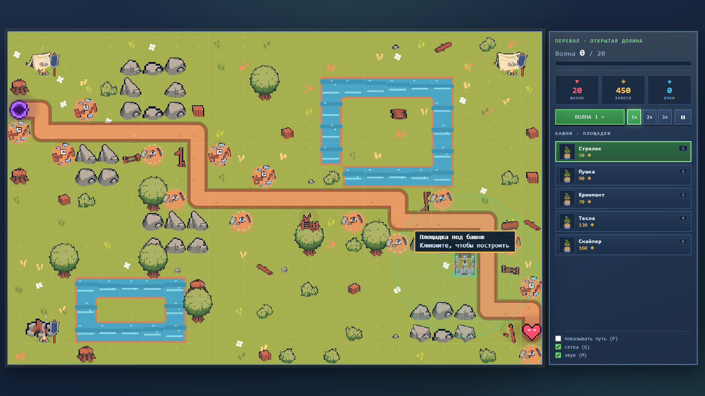

# Пиксельная Оборона

Tower Defense в браузере: яркая пиксельная графика в духе классических TD, шесть карт,
двенадцать волн на карту и фиксированные площадки под башни. Работает **полностью офлайн** — двойной
клик по `index.html`, без установки, без сборки, без интернета и без единого внешнего
файла: графика рисуется кодом, звук синтезируется.


> Учебный проект, третья работа после Telegram-бота и сайта.
> Архитектура, баланс и история решений — в [docs/HANDOFF.md](docs/HANDOFF.md).

## Запуск

Откройте `index.html` в браузере (Chrome, Edge, Firefox). Больше ничего не требуется:
ни сервера, ни Node.js, ни интернета.

## Возможности

* Шесть карт с разной геометрией: «Перевал» (открытая долина), «Ущелье» (каменные
  коридоры), «Болото» (озёра и извилистые тропы), «Чаща» (лесные завалы), «Крепость»
  (каменные дворы) и «Пепел» (выжженная пустошь).
* Пять типов башен — стрелок, пушка, криомант, тесла, снайпер — по три уровня улучшений.
  У каждой свой урон, радиус, скорость, тип атаки, цветная крыша и эмблема: стрела,
  пушка, снежинка, молния или прицел.
* Семь типов врагов: слизни, бегуны, рой, громилы, щитоносцы, летуны (игнорируют
  дорогу и летят напрямую) и боссы, которые при смерти делятся на трёх громил.
* Анимированные монстры (ходьба в трёх направлениях, смерть) и башни из отдельных
  наборов; у башни-стрелка в окне сидит лучник и стреляет.
* Восемнадцать фиксированных площадок на карту: одна площадка — одна башня. Строить можно
  только на них, поэтому игра не превращается в застройку всего поля, а каждая башня
  стоит там, где приносит пользу.
* Маршрут врагов считается алгоритмом A* и показан песчаной дорогой; площадки стоят
  вдоль дороги и не перекрывают путь.
* Двенадцать волн на карту, боссы на 6-й и 12-й, детерминированный генератор состава
  (одинаковый при перезапуске), досрочный запуск волны за бонус.
* Анимированное главное меню: поле, дорога, башня с лучником и идущие монстры.
* **Бестиарий** со всеми башнями и врагами, а в бою — подсказка при наведении курсора
  на врага или башню.
* Скорость 1×/2×/3×, пауза, сохранение рекордов и прогресса в браузере.
* Звук синтезируется на WebAudio — аудиофайлов нет.

## Скриншоты

| Меню | Выбор уровня |
|---|---|
|  |  |





## Управление

| Клавиша | Действие |
|---|---|
| `1`–`5` | выбор башни |
| ЛКМ | построить / выделить |
| ПКМ | отмена / продать |
| `N` | следующая волна досрочно |
| `Space` | пауза |
| `U` / `S` | улучшить / продать выделенную |
| `P` | показать путь врагов |
| `G` / `M` | сетка / звук |
| `Esc` | снять выделение / пауза |

## Структура

```
index.html            разметка и подключение скриптов
css/style.css         оформление (светлая фэнтезийная тема)
js/core/util.js       неймспейс TD, математика, RNG, форматирование
js/core/sprites.js    процедурный пиксель-арт: строки-палитры → offscreen canvas
js/core/assets.js     загрузка тайлсета, объектов и анимаций
js/core/menu-scene.js анимированная сцена главного меню
js/core/audio.js      синтез звуков на WebAudio
js/data/maps.js       шесть карт в виде ASCII-строк 28×17
js/data/defs.js       конфигурация, таблицы башен и врагов
js/data/waves.js      детерминированный генератор 12 волн
js/logic/grid.js      сетка, A*, проверка «путь не перекрыт»
js/game.js            игровой цикл, башни, враги, снаряды, отрисовка
js/ui.js              экраны, HUD, магазин, инспектор, сохранения, бестиарий
js/main.js            точка входа
assets/               сторонние наборы CraftPix (поле, башня, монстры)
  free-fields-tileset-pixel-art-for-tower-defense/  поле и объекты
  free-archer-towers-pixel-art-for-tower-defense/   анимации башни и лучника
  free-field-enemies-pixel-art-for-tower-defense/   анимации монстров
tests/run.js          юнит-тесты логики (Node)
tools/balance.js      симуляция баланса: бот проходит все карты
tools/ui-check.js     проверка интерфейса в headless-браузере
docs/                 документация и скриншоты
```

## Как это устроено

**Графика.** Поле, дорога, камни, деревья, трава, цветы, палатки и площадки под башни
берутся из набора **free-fields-tileset-pixel-art-for-tower-defense** (CraftPix):
`js/core/assets.js` загружает PNG локально и рисует их с `imageSmoothingEnabled = false`.
Из набора используются все варианты камней (16), кустов и травы (по 6), цветов (12),
палаток (6), фонарей (6), заборов (10), флажков (6), брёвен и ящиков (по 4), а также
анимированные флаги, костры и дым у лагерей. Башни и монстры — кадровые анимации из
наборов **free-archer-towers** и **free-field-enemies**: ходьба, смерть, выстрел лучника.
Объекты рисуются в натуральном или целочисленном масштабе (1×/2×/3×), поэтому камни
не «плывут» и не выглядят растянутыми. Башни отличаются цветом крыши и эмблемой типа.
Портал и сердце остаются процедурными спрайтами 16×16. Если ассеты не загрузились,
игра автоматически возвращается к цветному фолбэку и не падает.

**Без сборки и модулей.** Проект специально сделан на классических `<script>`:
Chrome блокирует ES-модули по `file://`, поэтому все файлы складывают код в глобальный
неймспейс `TD`. Порядок подключения важен: `util → sprites → assets → audio → maps →
defs → waves → grid → game → ui → main`.

**Площадки и A\*.** Сетка 28×17, клетка 52 px, canvas 1456×884. Враг ходит по центрам
клеток по 4 направлениям (без диагоналей). Площадки под башни генерируются детерминированно:
берутся клетки у дороги, разнесённые друг от друга, всего 18 на карту. Поставить башню
вне площадки нельзя, поэтому лабиринт из башен не строится, а маршрут врагов остаётся
читаемым. Маршрут фиксируется один раз при старте уровня: постройка и продажа башен
не меняют дорогу. A* всё равно считает путь от портала к сердцу и используется при
проверке безопасности постановки.

**Логика без DOM.** `TD.Game` не обращается к `document` или `canvas`: он получает `dt`,
отдаёт состояние и умеет рисовать через переданный `ctx`. Поэтому тесты и симуляция
баланса гоняют ту же игровую логику в Node.

**Баланс.** Старт: **360 золота** и 20 жизней. HP врага растёт на 16% за волну и на 10%
за карту; броня вычитается из урона, но не ниже 1 (снайпер её игнорирует). Награда за
волну `30 + 7 × номер`, досрочный запуск даёт `10 + 2 × номер` золота. Восемнадцать
площадок и три уровня улучшений заставляют выбирать, что строить, но симуляция
подтверждает: все шесть карт проходятся. Числа вынесены в `js/data/defs.js`, состав
волн — в `js/data/waves.js`.

## Тесты

```bash
node tests/run.js          # 32 юнит-теста логики и ассетов
node tools/balance.js      # бот проходит все 6 карт (симуляция)
node tools/ui-check.js     # 31 проверка интерфейса в headless Chrome/Edge
```

`tests/run.js` покрывает генерацию карт, A*, урон с бронёй, экономику,
детерминированность волн, победу/поражение, сохранения, работу без `localStorage`,
наличие ассетов и ограничение застройки площадками.

`tools/balance.js` запускает простого бота: он строит башни у маршрута, улучшает их и
запускает волны. На текущем балансе все шесть карт проходятся (12/12 волн).

`tools/ui-check.js` управляет настоящим браузером через DevTools Protocol: кликает по
магазину и canvas, проверяет постройку, улучшение, продажу, волну, паузу, сохранение,
экран результата и отсутствие ошибок в консоли.

## Отладка

Для скриншотов и быстрой проверки можно открыть игру сразу с нужным уровнем:

```
index.html?test=1&level=0&wave=1&ff=300&demo=1&path=1
```

* `level` — индекс карты (0–2);
* `wave` / `waveNum` — начать с первой / с указанной волны;
* `ff` — прокрутить N шагов симуляции (1/30 с) до отрисовки;
* `demo` — построить демонстрационный набор башен (выдаётся золото);
* `path=1` — сразу показать путь;
* `hover=enemy|tower` — навести подсказку на первого врага или башню.

## Ассеты и лицензия

Используются три набора CraftPix:
**Free Fields Tileset Pixel Art for Tower Defense** (поле и объекты),
**Free Archer Towers Pixel Art for Tower Defense** (башня, апгрейды, лучник) и
**Free Field Enemies Pixel Art for Tower Defense** (монстры: ходьба, смерть, атака).
Условия — в `License.txt` каждой папки
(https://craftpix.net/file-licenses/). Это Freebie-наборы: их разрешено использовать
в игре, в том числе коммерческой, но нельзя перепродавать или распространять как
самостоятельные исходники. Папки лежат в `assets/`, игра не обращается в интернет.

## Статус

Игра в активной разработке. Уже работают все экраны, шесть карт по 12 волн, пять
башен с улучшениями, семь типов врагов, сохранения и звук; тесты и симуляция баланса
проходят. Проект опубликован на GitHub, но не считается завершённым: баланс,
механики и контент продолжают дорабатываться, возможны изменения и ошибки.
